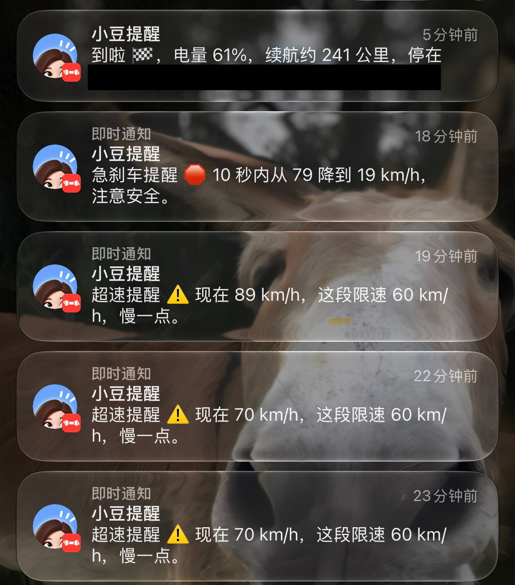

## 鸣谢

### 本项目由 MuseDrive 创作者一起共同探讨研究完成并落地，MuseDrive 作者链接：[muse-lab-cn/MuseDrive](https://github.com/muse-lab-cn/MuseDrive)

# 豆包&小豆 + 特斯拉推流推送通知部署（从 0 到 1）

> 让豆包（AI 助手）接管你的特斯拉：车主动推数据到你的服务器，豆包按规则发提醒到手机。
> 本教程已在真车跑通。照着做，一台车、一台服务器、一个豆包就能跑起来。
> 文中所有服务器地址、域名、密钥、位置等都用占位符表示，数字均为示例数据，部署时换成你自己的。

以下为iPhone Bark即时推送通知示例图：



## 目录

- [鸣谢](#鸣谢)
- [1. 占位符对照表](#1-占位符对照表)
- [2. 推送渠道对比表](#2-推送渠道对比表)
- [3. 架构](#3-架构)
- [4. 前置条件](#4-前置条件)
- [阶段 0. 准备工作](#阶段-0-准备工作)
- [阶段 1. 创建特斯拉应用](#阶段-1-创建特斯拉应用)
- [阶段 2. 密钥对与公钥托管](#阶段-2-密钥对与公钥托管)
- [阶段 3. 注册 partner](#阶段-3-注册-partner)
- [阶段 4. 授权拿令牌](#阶段-4-授权拿令牌)
- [阶段 5. 车里配虚拟钥匙](#阶段-5-车里配虚拟钥匙)
- [阶段 6. 服务器、域名、证书与分流](#阶段-6-服务器域名证书与分流)
- [阶段 7. 收流服务](#阶段-7-收流服务)
- [阶段 8. 下发推流配置](#阶段-8-下发推流配置)
- [阶段 9. 消费端：快照与行程记录](#阶段-9-消费端快照与行程记录)
- [阶段 10. 提醒机器人 watcher](#阶段-10-提醒机器人-watcher)
- [阶段 11. 推送渠道接入](#阶段-11-推送渠道接入)
- [阶段 12. 通知文案自定义](#阶段-12-通知文案自定义)
- [阶段 13. 实时查车与车辆控制](#阶段-13-实时查车与车辆控制)
- [阶段 14. 定时汇报与低胎压（可选）](#阶段-14-定时汇报与低胎压可选)
- [附录 A：免费与收费部署方案（分类对照）](#附录-a免费与收费部署方案分类对照)
- [排障](#排障)
- [安全提醒](#安全提醒)
- [检查清单](#检查清单)

---

## 1. 占位符对照表

> 全仓库占位符统一 `<全大写下划线>` 格式。每个占位符都标明了它的含义、去哪找。
> 部署时按表替换；替换完用 `grep -r "<" --include="*.py" --include="*.json" --include="*.service" .`
> 确认没有残留的 `<>` 占位符再启动服务。

| 占位符 | 含义 | 去哪找 / 格式 |
|---|---|---|
| `<SERVER_IP>` | 服务器公网 IP | 云厂商控制台 → 实例公网 IP，如 `1.2.3.4` |
| `<SERVER_USER>` | 服务器登录用户名 | 一般是 `ubuntu` 或 `root` |
| `<DOMAIN>` | 主域名 | 自己注册的域名 |
| `<APP_DOMAIN>` | 特斯拉应用域名（放公钥、做回调） | `<DOMAIN>` 的子域名，如 `app.<DOMAIN>` |
| `<TELEMETRY_DOMAIN>` | 推流域名（只接车的数据） | `<DOMAIN>` 的子域名，如 `telemetry.<DOMAIN>`；Funnel 路线时是 `<MACHINE_NAME>.<TAILNET_NAME>.ts.net` |
| `<MACHINE_NAME>` | Funnel 路线：家里那台机器在 Tailscale 里的机器名 | Tailscale 管理后台 Machines 页，如 `homelab`；别用真实姓名、车牌 |
| `<TAILNET_NAME>` | Funnel 路线：你的 tailnet 名 | Tailscale 管理后台，如 `tail1234`；完整地址是 `<MACHINE_NAME>.<TAILNET_NAME>.ts.net` |
| `<APP_NAME>` | 应用名 / 部署代号 | 英文，如 `DoubaoTesla`；服务名、目录名共用它 |
| `<CLIENT_ID>` | 特斯拉应用的 Client ID | 开发者后台建应用后显示 |
| `<CLIENT_SECRET>` | 特斯拉应用的 Client Secret | 只显示一次，马上存 600 权限文件 |
| `<VIN>` | 车架号 | 挡风玻璃左下角 / 特斯拉 App → 车辆信息，17 位 |
| `<CAR_NAME>` | 特斯拉车机里设的车辆昵称 | 车机 → 软件 → 车辆名称 |
| `<HOME_GCJ_LNG>` | 家附近经度（GCJ-02，高德坐标系） | 高德地图取点；不是 WGS-84 |
| `<HOME_GCJ_LAT>` | 家附近纬度（GCJ-02） | 同上 |
| `<HOME_AOI_NAME>` | 家附近高德 AOI 名字 | 高德逆地理编码返回的 AOI，如小区名；不知道留空 |
| `<BARK_DEVICE_KEY>` | Bark 的设备 key | iPhone 装 Bark App，打开即得 |
| `<BARK_TITLE>` | Bark 通知标题 | 自己定，如“小豆提醒” |
| `<AVATAR_URL>` | Bark 通知头像图片直链 | 公网能直接打开的图片 URL |
| `<AMAP_KEY>` | 高德 Web 服务 Key | 高德开放平台申请 |
| `<TELEGRAM_BOT_TOKEN>` | Telegram 机器人 token | Telegram 里找 `@BotFather` 新建机器人 |
| `<TELEGRAM_CHAT_ID>` | Telegram 聊天 ID | `getUpdates` 接口查 |
| `<WECOM_WEBHOOK_KEY>` | 企业微信群机器人 webhook key | 群设置 → 添加群机器人，复制地址里的 key |
| `<DINGTALK_ACCESS_TOKEN>` | 钉钉群机器人 access_token | 群设置 → 智能群助手 → 自定义机器人 |
| `<DINGTALK_SECRET>` | 钉钉加签 secret | 同上，选“加签”时才有 |
| `<FEISHU_HOOK_ID>` | 飞书群机器人 hook id | 群设置 → 群机器人，复制 webhook 地址最后一段 |
| `<FEISHU_SECRET>` | 飞书签名密钥 | 同上，开启签名校验时才有 |
| `<SERVERCHAN_SENDKEY>` | Server酱 SendKey | `sct.ftqq.com` 登录后复制 |
| `<PUSHPLUS_TOKEN>` | PushPlus token | `pushplus.plus` 登录后复制 |
| `<SMTP_HOST>` | 邮箱 SMTP 服务器地址 | 如 `smtp.qq.com` |
| `<SMTP_USER>` | 发件邮箱地址 | 自己的邮箱 |
| `<SMTP_AUTH_CODE>` | 邮箱 SMTP 授权码 | 邮箱设置里开 SMTP 后生成，不是登录密码 |
| `<NOTIFY_EMAIL>` | 收通知的邮箱 | 自己定 |
| `<PUSHOVER_TOKEN>` | Pushover 应用 token | `pushover.net` 建应用 |
| `<PUSHOVER_USER>` | Pushover 用户 key | 账号页 |
| `<PUSHDEER_KEY>` | PushDeer pushkey | `pushdeer.com` 登录后复制 |
| `<GOTIFY_URL>` | 自建 gotify 服务地址 | 如 `https://gotify.<DOMAIN>` |
| `<GOTIFY_TOKEN>` | gotify 应用 token | gotify 后台建应用 |
| `<NTFY_TOPIC>` | ntfy 话题名 | 自己定，别用车牌、姓名 |
| `<TELEMETRY_FULLCHAIN_PEM>` | 推流域名证书全链 PEM 原文 | `/etc/letsencrypt/live/<TELEMETRY_DOMAIN>/fullchain.pem` |
| `<PRIVATE_KEY_PATH>` | EC 私钥文件路径 | 自己生成的 prime256v1 私钥，600 权限 |
| `<ACCESS_TOKEN>` | 特斯拉 access token | 阶段 4 授权后换到，8 小时有效，自动刷新 |
| `<PARTNER_TOKEN>` | partner token（临时） | 阶段 3 用 client_credentials 换到，有效期 8 小时，用完即弃 |
| `<PEAK_PRICE>` | 峰时电价（元/度） | 当地电价 |
| `<VALLEY_PRICE>` | 谷时电价（元/度） | 当地电价 |
| `<BATTERY_USABLE_KWH>` | 电池可用电量（度） | 按车型，如 `57` |
| `<LOW_RANGE_KM>` | 低续航阈值（公里） | 自己定，如 `100` |

---

## 2. 推送渠道对比表

> 先选渠道再部署。主渠道 1 个 + 备用渠道 1 个就够了，渠道越多，漏推、重复推的坑越多。
> 各渠道的申请步骤与接入代码见 [阶段 11](#阶段-11-推送渠道接入)，函数都在 `templates/push_channels.py`。

| 渠道 | 免费 | 要翻墙 | iOS 推送是否及时 | 配置难度 | 适合谁 |
|---|---|---|---|---|---|
| Bark | 是 | 否 | 及时（APNs） | 易 | iPhone 用户首选，本教程默认 |
| Telegram Bot | 是 | 是（大陆服务器直连不通） | 及时 | 中 | 已在用 Telegram 的人 |
| 企业微信群机器人 | 是 | 否 | 及时 | 易 | 用企业微信的家庭 / 团队 |
| 钉钉群机器人 | 是 | 否 | 及时 | 易 | 用钉钉的人 |
| 飞书群机器人 | 是 | 否 | 及时 | 易 | 用飞书的人 |
| Server酱 | 免费版每天 5 条 | 否 | 较及时（微信消息） | 易 | 提醒少的轻量用户 |
| PushPlus | 免费版有限额 | 否 | 较及时（微信服务号） | 易 | 想推到微信的人 |
| 邮件 SMTP | 是 | 否 | 不及时（邮件 App 拉取） | 中 | 做备份渠道 |
| Pushover | 否（约 5 美元一次性） | 可能慢 | 及时 | 中 | 愿付费求稳的人 |
| PushDeer | 是 | 否 | 及时 | 易 | 轻量、国内服务 |
| gotify | 是（自建） | 否 | 及时（需 App 后台） | 难 | 爱折腾、要完全自有 |
| ntfy | 是 | 否 | 及时 | 易 | 极简、能接受话题公开 |

---

## 3. 架构

```text
特斯拉车机 ──WebSocket(TLS)──▶ 服务器 443 ──nginx stream 按域名分流──▶ 收流服务 8445
                                                                      │
                                                                      ▼
                                              consumer：读 journal → telemetry_latest.json
                                                                      │
                                                                      ▼
                                              watcher：每秒判定 8 种提醒 → alert-outbox.json
                                                                      │
                                                                      ▼
                                              推送脚本：读 outbox → Bark / 微信 / 钉钉… → 手机
```

- 车主动推数据到服务器，不是服务器去问车。
- 提醒只读日志，不唤醒车、不发车辆命令（查车与控制见阶段 13，是另一条线）。
- 一辆车最多配 5 个应用同时推流，本教程只占 1 个。

---

## 4. 前置条件

| 项 | 要求 |
|---|---|
| 特斯拉账号 | 车主本人账号，中国区；固件 2024.26 以上 |
| 服务器 | 1 台云服务器，能开 443 端口；有 root 或 sudo |
| 域名 | 1 个，有 DNS 解析权限；要 2 个子域名（应用 + 推流） |
| 手机 | iPhone 装 Bark App（默认渠道）；另装豆包 App、特斯拉 App |
| 电脑 | 能跑命令（编译在电脑上做，编好传服务器；服务器上不用装 Go） |

> 有 5 件事必须车主亲手做，AI 代不了：开发者账号登录和授权、特斯拉 App 里配虚拟钥匙、
> 域名解析和安全组放行、车上软件更新、选方案。除此之外都能照着文档做。

---

## 阶段 0. 准备工作

- 步骤 1：服务器上建目录（后面所有文件都放这里）。

```bash
mkdir -p /home/<SERVER_USER>/fleet-telemetry-<APP_NAME>/{consumer,scripts,state,credentials,keys}
chmod 700 /home/<SERVER_USER>/fleet-telemetry-<APP_NAME>/credentials /home/<SERVER_USER>/fleet-telemetry-<APP_NAME>/keys
```

- 步骤 2：记好两个子域名，后面不再改：应用域名 `<APP_DOMAIN>`、推流域名 `<TELEMETRY_DOMAIN>`。

**验证方法**：`ls /home/<SERVER_USER>/fleet-telemetry-<APP_NAME>/`，预期看到 5 个目录。

---

## 阶段 1. 创建特斯拉应用

- 步骤 1：打开中国区开发者网站 `developer.tesla.cn`，用车主的特斯拉账号登录（必须车主本人）。
- 步骤 2：新建应用，名字用英文，如 `<APP_NAME>`；说明写个人自用、不商用、不高频查。
- 步骤 3：权限只选 3 个：`vehicle_device_data`、`vehicle_location`、`vehicle_cmds`（以后要管充电再加 `vehicle_charging_cmds`，加了要重新授权）。
- 步骤 4：允许的域名只写裸域名 `<APP_DOMAIN>`（不要带路径、不要带斜杠）。
- 步骤 5：回调地址写完整地址 `https://<APP_DOMAIN>/callback`，返回地址写同一个。
- 步骤 6：保存后拿到 `<CLIENT_ID>` 和 `<CLIENT_SECRET>`；后者只显示一次，马上存进服务器 600 权限文件，绝不要贴聊天、不要进仓库。

```bash
printf '%s' '<CLIENT_SECRET>' > /home/<SERVER_USER>/fleet-telemetry-<APP_NAME>/credentials/client_secret
chmod 600 /home/<SERVER_USER>/fleet-telemetry-<APP_NAME>/credentials/client_secret
```

**验证方法**：开发者后台里应用状态显示有效。

---

## 阶段 2. 密钥对与公钥托管

- 步骤 1：在服务器上生成 EC 密钥对（prime256v1）。

```bash
openssl ecparam -genkey -name prime256v1 -noout -out /home/<SERVER_USER>/fleet-telemetry-<APP_NAME>/keys/private-key.pem
openssl ec -in /home/<SERVER_USER>/fleet-telemetry-<APP_NAME>/keys/private-key.pem -pubout -out /home/<SERVER_USER>/fleet-telemetry-<APP_NAME>/keys/public-key.pem
chmod 600 /home/<SERVER_USER>/fleet-telemetry-<APP_NAME>/keys/private-key.pem
```

- 步骤 2：私钥绝不要发给任何人、不要贴聊天、不要进仓库；公钥放到应用域名的这个地址。

```text
https://<APP_DOMAIN>/.well-known/appspecific/com.tesla.3p.public-key.pem
```

- 步骤 3：公钥只能放在应用域名这个普通网站上，不要放在推流域名（推流域名只讲 WebSocket，不回网页）。

**验证方法**：`curl -s https://<APP_DOMAIN>/.well-known/appspecific/com.tesla.3p.public-key.pem`，
预期返回 200 且内容与本地 `public-key.pem` 一字不差。
坑：有些网站会把不存在的地址也返回首页，一定要核对内容确实是公钥。

---

## 阶段 3. 注册 partner

- 步骤 1：用 `<CLIENT_ID>` 和 `<CLIENT_SECRET>` 拿 partner token（`grant_type=client_credentials`，audience 写中国区接口地址）。

```bash
curl -s https://auth.tesla.cn/oauth2/v3/token -X POST \
  -d "grant_type=client_credentials&client_id=<CLIENT_ID>&client_secret=<CLIENT_SECRET>&scope=openid%20offline_access&audience=https://fleet-api.prd.cn.vn.cloud.tesla.cn"
```

- 步骤 2：用 partner token 注册 partner 账号（body 里写裸域名）。

```bash
curl -s https://fleet-api.prd.cn.vn.cloud.tesla.cn/api/1/partner_accounts -X POST \
  -H "Authorization: Bearer <PARTNER_TOKEN>" -H "Content-Type: application/json" \
  -d '{"domain": "<APP_DOMAIN>"}'
```

**验证方法**：预期返回 200，说明应用、域名、公钥三者对上了。
排障：返回 `412` 是应用登记的 allowed origin 与 partner 域名根域不一致，
去开发者后台把 `<APP_DOMAIN>` 加为 allowed origin（保留原有条目，不要替换），再试一次；
返回 `client_not_found` 是用了全球地址，换回中国区地址再试。

---

## 阶段 4. 授权拿令牌

- 步骤 1：拼授权链接（带上 `<CLIENT_ID>`、回调地址、`response_type=code`、3 个权限、`openid`、`offline_access`），发给车主。
- 步骤 2：车主在自己手机或电脑浏览器里打开链接（不要用特斯拉 App 打开），登录并确认应用名字和权限。
- 步骤 3：浏览器跳回回调地址，地址里带一个 `code`；马上用 curl 把 code 换成令牌（code 只能用一次，过期作废，不要重试旧 code）。
- 步骤 4：令牌存进 600 权限文件，绝不要贴聊天、不要进仓库。

**验证方法**：`curl -s https://fleet-api.prd.cn.vn.cloud.tesla.cn/api/1/vehicles -H "Authorization: Bearer <ACCESS_TOKEN>"`，
预期返回车辆列表。令牌有效期：access token 8 小时，refresh token 约 3 个月，每次刷新都会换新，旧的作废。

---

## 阶段 5. 车里配虚拟钥匙

- 步骤 1：必须先做完阶段 4 授权，再配钥匙，不然会报错。
- 步骤 2：车主在手机上打开 `https://tesla.com/_ak/<APP_DOMAIN>`，跳到特斯拉 App，按提示把钥匙加进车里（必须车主亲手点）。

**验证方法**：调 `fleet_status`，预期 `key_paired_vins` 里有这辆车；或发一条闪灯命令成功（见阶段 13）。

---

## 阶段 6. 服务器、域名、证书与分流

> 不想租服务器？先看附录 A：免费与收费部署方案（分类对照）。Oracle 永久免费 VPS 与主线部署完全一样；Tailscale Funnel + 家里常开机器 0 元也能收推流，但入口做法不同（阶段 6–7 按附录 A.2.2 替换）。

- 步骤 1：两个子域名各加一条 A 记录指向 `<SERVER_IP>`，TTL 设 600。
- 步骤 2：云控制台安全组放行 443 端口入方向。
- 步骤 3：用 certbot 给两个域名各申请一张 Let's Encrypt 证书（HTTP-01 验证，webroot 方式）。

```bash
sudo certbot certonly --webroot -w /var/www/html -d <APP_DOMAIN> -d <TELEMETRY_DOMAIN>
```

- 注意：千万不要用 `certbot --nginx`，它会在 443 上加网站块抢端口。
- 步骤 4：nginx 在 443 端口按域名分流（须装 `libnginx-mod-stream`，`ssl_preread on`）：推流域名进收流服务端口，应用域名进网站端口；不要做 http 跳 https。

| 域名 | 去向 |
|---|---|
| `<TELEMETRY_DOMAIN>` | 收流服务（本教程用 8445） |
| `<APP_DOMAIN>` 与其他 | 网站（本教程用 8444，上面放公钥与 `/callback` 页） |

**验证方法**：`openssl s_client -connect <TELEMETRY_DOMAIN>:443 -servername <TELEMETRY_DOMAIN>`，
预期 `Verify return code: 0 (ok)`。
注意：推流域名只讲 WebSocket，`curl` 返回 000 是正常的；应用域名是普通网站，`curl` 应返回 200。

---

## 阶段 7. 收流服务

- 步骤 1：在有 Go 的电脑上编译官方仓库 `github.com/teslamotors/fleet-telemetry`（版本 v0.9.5），需要 Go 1.27 与 `libzmq`、`libsodium` 开发库；编好把二进制传到服务器（服务器上不用装 Go）。

```bash
# 本机编译示例
go build -o fleet-telemetry ./cmd/server
scp -i ~/.ssh/id_ed25519 fleet-telemetry <SERVER_USER>@<SERVER_IP>:/home/<SERVER_USER>/fleet-telemetry-<APP_NAME>/
```

- 步骤 2：写收流配置 `consumer/server_config.json`（模板见 `templates/`，改域名与证书路径）。

```json
{
  "host": "127.0.0.1",
  "port": 8445,
  "tls": {
    "server_cert": "/etc/letsencrypt/live/<TELEMETRY_DOMAIN>/fullchain.pem",
    "server_key": "/etc/letsencrypt/live/<TELEMETRY_DOMAIN>/privkey.pem"
  }
}
```

- 注意：服务只听 `127.0.0.1:8445`，不直接听 443；443 由 nginx 的 stream 按域名透传进来。
- 步骤 3：装 systemd 服务（模板 `templates/systemd/fleet-telemetry-doubao.service`），服务以 root 运行（要读证书私钥，默认 root 600）。

```bash
sudo cp templates/systemd/fleet-telemetry-doubao.service /etc/systemd/system/
sudo systemctl daemon-reload && sudo systemctl enable --now fleet-telemetry-doubao
```

**验证方法**：`systemctl is-active fleet-telemetry-doubao`，预期 `active`；`ss -ltnp | grep 8445`，预期端口在监听。

---

## 阶段 8. 下发推流配置

- 步骤 1：编译 `vehicle-command` 仓库里的 `tesla-http-proxy`，只在发配置时临时启动，监听 `127.0.0.1:4443`。
- 步骤 2：用模板 `templates/fleet_telemetry_config.json`（180 个字段，见下表）生成下发 payload，填好 `<VIN>`、`<TELEMETRY_DOMAIN>` 与证书全链。

| 间隔 | 字段数 | 举例 |
|---|---|---|
| 1 秒 | 15 | `ChargeAmps`、`DetailedChargeState`、胎压 4 轮 + 报警 |
| 10 秒 | 36 | `VehicleSpeed`、`Gear`、`BrakePedal`、`Location`、驾驶辅助 |
| 60 秒 | 129 | `Soc`、`EstBatteryRange`、`Odometer`、充电、空调、媒体 |
| 合计 | 180 | 字段表见 `templates/telemetry-fields-180.json` |

- 步骤 3：发配置（路径里不带 VIN，VIN 在 body 里；proxy 自动签名）。

```bash
# 起代理（用完即停）
tesla-http-proxy -key-file <PRIVATE_KEY_PATH> -host 127.0.0.1 -port 4443 \
  -cert /tmp/proxy-cert.pem -tls-key /tmp/proxy-key.pem &
# 发配置
curl -sk https://127.0.0.1:4443/api/1/vehicles/fleet_telemetry_config -X POST \
  -H "Authorization: Bearer <ACCESS_TOKEN>" -H "Content-Type: application/json" \
  -d @/home/<SERVER_USER>/fleet-telemetry-<APP_NAME>/config_payload.json
```

**验证方法**：预期返回 `{"response":{"updated_vehicles":1}}`；
随后查 `fleet_telemetry_config`，预期 `synced` 为 `true`（车睡着时是 `false`，属正常，等车下次联网自动变 `true`），`fleet_telemetry_errors` 为空列表；
约 5 分钟内服务器日志里收到第一批数据包，就是通了。

> 关键点：
> - 距离类字段单位是英里：`EstBatteryRange`、`Odometer`、`VehicleSpeed`、`MilesToArrival` 都是英里，展示时 ×1.60934 换回公里；低续航阈值 100 公里 = **62.14 英里**，判断用英里数值。
> - 字段名必须用官方枚举里的名字，写错一个，整条配置都会被拒。
> - 充电那 5 个名字（如 `ChargingState`）不能直接用，要用等效名字（`DetailedChargeState` / `ChargeState`、`AC/DCChargingPower`、`ChargeRateMilePerHour`、`DC/ACChargingEnergyIn`、`ChargingCableType`）。
> - 车报 `unsupported_field` 的字段就删掉重发；个别字段要求 `minimum_delta` 或特定间隔，按报错改。
> - 证书 90 天续期一次，续期后检查车辆配置里的证书链要不要重发。

---

## 阶段 9. 消费端：快照与行程记录

- 步骤 1：装 consumer（模板 `templates/telemetry_consumer.py`），每秒读一次收流服务的 journal。
- 步骤 2：它维护 3 份文件（都在 `state/` 下，0600 权限）。

| 文件 | 内容 |
|---|---|
| `telemetry_latest.json` | 最新快照：电量、续航、胎压、位置、车速、锁车、充电、温度、里程 |
| `telemetry_trips.jsonl` | 一次开车一条行程记录（见下） |
| `telemetry_trip_open.json` | 正在开的这趟（断点续记用，落盘后删除） |

- 行程落盘规则（模板里是真实逻辑）：挂 D/R 档或车速 > 0.5 km/h 开一趟；停稳满 5 分钟落盘，`end_time` 取最后一次动的时间（停车后等的 5 分钟不算进行程时长）；不足 0.1 公里且不足 1 分钟的行程丢弃；耗电按电量差 × 电池容量估算（`BATTERY_KWH`，按自己车型改，模板默认 57）；轨迹每 10 秒采一个点；consumer 重启时读到没落盘的 trip，停稳已满 5 分钟就按最后一次动的时间估算落盘（`estimated: true`）。
- 行程记录只存经纬度，不存地名：地名是发提醒时现查高德逆地理编码得到的（阶段 12 与 bark_push 模板）。
- 一条行程记录长这样（模板 `templates/telemetry_trips.example.jsonl`，示例数据，与任何真实行程无关，轨迹略）：

```json
{"id": "trip-20261120-083000", "start_time": "2026-11-20T08:30:00+08:00", "end_time": "2026-11-20T08:47:20+08:00", "distance_km": 12.5, "duration_sec": 1040, "avg_speed_kmh": 43.3, "max_speed_kmh": 88.0, "start_soc": 80, "end_soc": 75, "energy_kwh": 2.9, "estimated": false, "trace": [...]}
```

- 注意：充电会话落盘（`telemetry_charging.jsonl`，一次充电一条）模板还没写，只有快照里的充电状态是现成的；先跑通快照与行程，充电落盘后续再补。
- 步骤 3：装 systemd 服务（模板 `templates/systemd/fleet-telemetry-doubao-consumer.service`）并启动。
- 注意：V 数据包是增量形态（每包只带变化字段），要跨包合并；`journalctl -o json` 会丢大包，必须用 `-o cat --show-cursor` + `--after-cursor` 增量读。

**验证方法**：`cat /home/<SERVER_USER>/fleet-telemetry-<APP_NAME>/state/telemetry_latest.json`，
预期 `updated_at` 是最近一分钟内的，且电量、续航与车上显示一致。
开车实测一趟：停车满 5 分钟后 `tail -1 .../state/telemetry_trips.jsonl` 应多一条，里程与用时对得上。

---

## 阶段 10. 提醒机器人 watcher

- 步骤 1：装 watcher（模板 `templates/tesla_watcher.py`），每秒轮询一次快照，按规则写提醒进 `state/alert-outbox.json`；只读日志，不唤醒车、不发车辆命令。
- 步骤 2：装 systemd 服务（模板 `templates/systemd/tesla-watcher-doubao.service`）并启动。

| 提醒 | 判据 | 去重 |
|---|---|---|
| 启动 | 新一趟第一次挂 D 或 R 档 | 每趟 1 次；光唤醒不报 |
| 停车 | 开动过、连续停满 5 分钟 | 每次停车 1 次；5 分钟内短停不报 |
| 低续航 | 续航低于 `<LOW_RANGE_KM>` 公里 | 低于阈值期间不重复；充回去重待命 |
| 急刹 | 10 秒内降 60 km/h 以上且踩刹车，或纵向加速度 ≤ -4.0 且踩刹车 | 同趟 60 秒内不重复 |
| 超速 | 超分段限速 5 公里以上（高速 120 / 高架 80 / 市区 60 / 接驳 40，固定分段兜底，不是官方限速） | 降回限速以下 3 公里重待命，两次至少隔 60 秒 |
| 充电开始 / 充满 / 中途停 | 充电状态变化 | 每会话各 1 次 |
| 去陌生地方 | 去不常去的地方开动 5 分钟后问一次 | 常去地点自动学（30 天内同一粗略位置停过 2 次以上） |

- 注意：两个进程写同一个 outbox 时，临时文件名必须带进程号区分（模板已处理），不要改回共用同一个 `.tmp` 文件名，否则 `os.replace` 会撞车。

**验证方法**：手动跑一次 `python3 consumer/tesla_watcher.py --once`，预期打印 outbox 内容；
开车实测一趟，启动、超速、停车提醒都对得上。

---

## 阶段 11. 推送渠道接入

> 接入方式统一：推送脚本每 2 秒读 `state/alert-outbox.json`，有 `pending` 就调对应函数发掉，再标 `sent`。
> 模板 `templates/bark_push.py` 是完整实现（Bark 主渠道 + 夜间缓冲 + 测试开关），
> 其他渠道的函数都在 `templates/push_channels.py`，按需 import 调用。
> 所有渠道共用同一份文案（阶段 12），不用每个渠道各写一套。

### 11.1 Bark（默认主渠道）

- 步骤 1：iPhone 装 Bark App，打开即得 `<BARK_DEVICE_KEY>`。
- 步骤 2：写进 `credentials/bark_push.json`（模板 `templates/credentials/bark_push.example.json`，600 权限）。

```json
{"bark_key": "<BARK_DEVICE_KEY>"}
```

- 步骤 3：标题 `<BARK_TITLE>`、头像 `<AVATAR_URL>` 在 `templates/bark_push.py` 顶部改。
- 接入代码：`send_bark(title, body, level)`，`level` 用 `timeSensitive`（启动、超速、急刹、低续航）或 `active`（其他）。
- 优点一句话：iOS 推送最及时，免费，不用翻墙。
- 夜间规则：23:30–07:00 充电充满 / 中途停不立即推，攒到早上 07:00 发一条汇总。

**验证方法**：`python3 scripts/bark_push.py --once --dry-run`，预期打印要发的内容但不真发；
去掉 `--dry-run` 再跑一次，预期手机立刻收到一条测试提醒。

### 11.2 Telegram Bot

- 步骤 1：Telegram 里找 `@BotFather` → `/newbot` → 得 `<TELEGRAM_BOT_TOKEN>`。
- 步骤 2：给机器人发一条消息，用 `getUpdates` 查 `<TELEGRAM_CHAT_ID>`。
- 步骤 3：服务器在中国大陆时直连 `api.telegram.org` 不通，须走代理（给推送脚本配 `https_proxy` 环境变量）。
- 接入代码：`send_telegram(title, body)`。
- 优点一句话：免费、稳定，但要翻墙。

**验证方法**：跑一次 `send_telegram("测试", "测试")`，预期 Telegram 立刻收到。

### 11.3 企业微信群机器人

- 步骤 1：企业微信群 → 右上角 … → 添加群机器人 → 复制 webhook 地址里的 `<WECOM_WEBHOOK_KEY>`。
- 接入代码：`send_wecom(title, body)`。
- 优点一句话：免费、不用翻墙，但只能发到群里，不能私聊个人。

**验证方法**：跑一次，预期群里立刻出现一条 markdown 消息。

### 11.4 钉钉群机器人

- 步骤 1：钉钉群 → 群设置 → 智能群助手 → 添加机器人 → 选“自定义” → 复制 `<DINGTALK_ACCESS_TOKEN>`。
- 步骤 2：如选“加签”，把 `<DINGTALK_SECRET>` 一并记下（不加签也能用，建议加签）。
- 接入代码：`send_dingtalk(title, body)`。
- 优点一句话：免费、不用翻墙，群里直接收到。

**验证方法**：跑一次，预期群里立刻出现一条文本消息。

### 11.5 飞书群机器人

- 步骤 1：飞书群 → 设置 → 群机器人 → 添加机器人 → 复制 webhook 地址最后一段 `<FEISHU_HOOK_ID>`。
- 步骤 2：如开启签名校验，把 `<FEISHU_SECRET>` 记下。
- 接入代码：`send_feishu(title, body)`。
- 优点一句话：免费、不用翻墙，群里直接收到。

**验证方法**：跑一次，预期群里立刻出现一条文本消息。

### 11.6 Server酱

- 步骤 1：`sct.ftqq.com` 微信扫码登录 → 复制 `<SERVERCHAN_SENDKEY>`。
- 接入代码：`send_serverchan(title, body)`。
- 优点一句话：配置最简单，但免费版每天 5 条，提醒多的人别用它做主渠道。

**验证方法**：跑一次，预期微信立刻收到服务通知。

### 11.7 PushPlus

- 步骤 1：`pushplus.plus` 微信扫码登录 → 复制 `<PUSHPLUS_TOKEN>`。
- 接入代码：`send_pushplus(title, body)`（`channel=wechat` 时推到微信服务号消息里）。
- 优点一句话：能推到微信，但免费版有限额。

**验证方法**：跑一次，预期微信服务号立刻收到。

### 11.8 邮件 SMTP

- 步骤 1：邮箱开 SMTP 服务并拿到授权码（不是登录密码）；QQ 邮箱在设置 → 账户 → 开启 IMAP/SMTP 后生成。
- 接入代码：`send_email(title, body)`。
- 优点一句话：免费、不用翻墙，但 iOS 邮件 App 收信不及时，只适合做备份渠道。

**验证方法**：跑一次，预期收件箱立刻收到一封邮件。

### 11.9 Pushover

- 步骤 1：`pushover.net` 注册 → 建应用得 `<PUSHOVER_TOKEN>`，账号页得 `<PUSHOVER_USER>`。
- 接入代码：`send_pushover(title, body)`。
- 优点一句话：iOS 推送很稳，但约 5 美元一次性付费，大陆服务器直连可能慢。

**验证方法**：跑一次，预期手机立刻收到。

### 11.10 PushDeer

- 步骤 1：`pushdeer.com` 微信扫码登录 → 复制 `<PUSHDEER_KEY>`；手机装 PushDeer App 扫码绑定。
- 接入代码：`send_pushdeer(title, body)`。
- 优点一句话：免费、国内服务、不用翻墙。

**验证方法**：跑一次，预期手机立刻收到。

### 11.11 gotify（自建）

- 步骤 1：自己服务器上装 `gotify/server` → 建应用得 `<GOTIFY_TOKEN>`，服务地址记为 `<GOTIFY_URL>`。
- 接入代码：`send_gotify(title, body)`。
- 优点一句话：全程走自己的服务器，数据不经过第三方；缺点是手机端要装 gotify App 且保持后台。

**验证方法**：`curl <GOTIFY_URL>/message?token=<GOTIFY_TOKEN> -X POST -d '{"title":"测试","message":"测试"}'`，预期手机立刻收到。

### 11.12 ntfy（免费）

- 步骤 1：不用申请，话题名就是地址；手机装 ntfy App → 订阅同一个 `<NTFY_TOPIC>`。
- 接入代码：`send_ntfy(title, body)`。
- 优点一句话：极简免费；缺点是公共服务的话题名公开可猜，别用车牌、姓名当话题名。

**验证方法**：跑一次，预期手机立刻收到。

---

## 阶段 12. 通知文案自定义

> 文案按实际读到的数据现写，不编造没有的数据；读不到写“未读到”。
> 下表是 8 种提醒的模板写法，数字、地点、时间均为**示例数据**，
> 语气保留原样。改文案只改 `templates/bark_push.py` 里的 `build_text`，判定规则不要动。

| 提醒 | 文案模板（示例数据） |
|---|---|
| 启动 | 出发啦 🚗，电量 80%，续航约 300 公里，晴，22°C，示例地名。薄外套或长袖就行。 |
| 停车 | 到啦 🏁，本次行程 12.5 公里，用时 18 分钟，电量 75%，续航约 280 公里，停在示例地名。 |
| 超速 | 超速提醒 ⚠️ 现在 75 km/h，这段限速 60 km/h，慢一点。 |
| 急刹 | 急刹车提醒 🛑 10 秒内从 80 降到 20 km/h，注意安全。 |
| 低续航 | 电量低提醒 🔋 续航只剩约 90 公里，记得充电。附近充电站：示例充电站名（300 米）。 |
| 充电开始 | 开始充电 🔌，电量 40%，上限 80%，功率 7 kW，预计约 3 小时充满，地点：示例地名（家充）。 |
| 充满 | 充满啦 ✅，这次充了 30.0 度，电费 ¥18.00。 |
| 中途停充 | 充电停了 ⏸️，这次充了 12.5 度（估算），电费 ¥7.50。 |

- 启动文案后加一句穿衣建议（按温度分档，报雨加带伞）：

| 温度 | 建议 |
|---|---|
| < 10°C | 穿厚点 |
| 10–16°C | 薄外套加长袖 |
| 17–24°C | 薄外套或长袖就行 |
| 25–30°C | 短袖防晒 |
| > 30°C | 注意防暑 |
| 下雨 | 再加一句“记得带伞” |

- 停车文案后加一句行程小结（本次行程 X 公里、用时 X 分钟，有数才写）。
- 充电计费：家充按峰谷电价算（峰 8:00–22:00、谷 22:00–次日 8:00，示例价见占位符表 `<PEAK_PRICE>` / `<VALLEY_PRICE>`，按当地实际电价改）；
  家充判定：离家 300 米内，或高德逆地理编码的 AOI 等于 `<HOME_AOI_NAME>`；
  外面充电桩用高德查价，查不到就说查不到，不要编。
- 低续航文案后附最近 3 个真充电站（高德 around 接口查，查不到写“没查到”）。

**验证方法**：`python3 scripts/bark_push.py --once --dry-run`，预期打印的文案与上表格式一致，数字来自当前快照。

---

## 阶段 13. 实时查车与车辆控制

> 这套部署不只是被动推送，还能主动查车、发指令。查车与控制走 Fleet API，是另一条线，
> 与推流提醒互不干扰。控制类命令一律走签名代理，不要直接调 REST。

### 能查什么

| 数据项 | 来源 | 说明 |
|---|---|---|
| 电量 / 续航 | 推流现成（`Soc` / `EstBatteryRange`，英里） | 车醒着才有新数；睡着显示上次数并标时间 |
| 车门开闭 | 推流现成（`DoorState`） | 空 = 全关 |
| 车窗开闭 | Fleet API 现查（`fd/fp/rd/rp_window`） | 推流 180 字段里没有车窗，须现查 |
| 是否上锁 | 推流现成（`Locked`） | 现查结果一致 |
| 总里程 | 推流现成（`Odometer`，英里） | 展示 ×1.60934 换公里 |
| 胎压 | 推流现成（`TpmsPressureFl/Fr/Rl/Rr`，bar） | 低于 2.6 bar 才提醒 |
| 位置 | 推流现成（`Location`，WGS-84） | 对外只发地图链接，不发原始坐标 |
| 充电状态 / 功率 / 上限 / 预计充满 | 推流现成（`ChargeState` / `AC·DCChargingPower` / `ChargeLimitSoc` / `TimeToFullCharge`） | 充电时才有功率 |

- 现查方法：`GET /api/1/vehicles/<VIN>/vehicle_data`；车睡着先调 `wake_up`，等状态变 `online`（约 10–60 秒）再读；读不到写「未读到」，不编造。
- 推流里没有灯光状态，面板只能发闪灯，不能显示灯开着还是关着。

### 能控什么

| 指令 | 接口名 | 用途 | 注意事项 |
|---|---|---|---|
| 闪灯 | `flash_lights` | 停车场找车 | 真命令；半夜别用 |
| 鸣笛 | `honk_horn` | 找车 | 真命令；注意扰民 |
| 开锁 / 落锁 | `door_unlock` / `door_lock` | 远程开关门 | 敏感：每次单独确认，不进自动化 |
| 前备箱 / 后备箱 | `actuate_trunk` | 远程开盖 | 敏感：确认周围没人没障碍 |
| 空调开关与温度 | `remote_start_climate` / `set_temps` | 提前制冷 / 制热 | 温度设 17–28°C；先开空调再调座椅加热 |
| 座椅加热 | `remote_seat_heater_request` | 按座位调档 | 0 关 / 1 低 / 2 中 / 3 高；部分车型无后排加热，没有就别加 |
| 充电开始 / 停止 | `charge_start` / `charge_stop` | 远程控制充电 | 充电口电压异常时车会拒绝执行，先查充电状态 |
| 充电上限 | `set_charge_limit` | 设上限百分比 | 50–100 |
| 除霜 | `set_preconditioning_max` | 冬天除霜 | 真命令 |
| 露营模式 | `set_camp_mode` | 车内过夜 | 真命令 |
| 宠物模式 | `set_dog_mode` | 短时留宠物在车内 | 真命令；仍需留意车内温度 |
| 远程启动 | `remote_start_drive` | 无钥匙开车 | 高敏感：不建议接入任何自动化，用前单独确认 |

### 怎么发指令（最小示例）

```bash
# 1) 起签名代理（只在发命令时临时启动，用完即停）
tesla-http-proxy -key-file <PRIVATE_KEY_PATH> -host 127.0.0.1 -port 4443 \
  -cert /tmp/proxy-cert.pem -tls-key /tmp/proxy-key.pem &
# 2) 闪灯（示例）
curl -sk https://127.0.0.1:4443/api/1/vehicles/<VIN>/command/flash_lights \
  -H "Authorization: Bearer <ACCESS_TOKEN>"
# 预期：{"response":{"result":true,"reason":""}}
```

- 控制命令必须走签名代理，直接调 REST 会报签名错误；车睡着先唤醒再发。
- 敏感命令（开锁、开盖、远程启动、充电变更）每次单独确认，绝不写进自动化里自动执行。

### 做不到的事（如实写，别让人误以为能做）

| 事 | 原因 |
|---|---|
| 中国区看不了哨兵实时画面 | 地区限制，车机、App 都没有入口；只能看哨兵录像（车机 / App / U 盘） |
| 没有地锁官方接口 | 特斯拉没有这个接口 |
| 车机装不了第三方 App、不支持 CarPlay | 车机是封闭系统；导航用手机地图分享到特斯拉 App 发到车上 |
| 推流里没有灯光状态、没有车窗状态 | 灯光只能发闪灯不能读状态；车窗走 Fleet API 现查 |

**验证方法**：发一条闪灯命令，预期返回 `result: true` 且车灯闪一下；再读一次 `vehicle_data`，预期锁车状态与实际一致。

---

## 阶段 14. 定时汇报与低胎压（可选）

| 汇报 | 时间（示例时间，按自己习惯改） | 内容 |
|---|---|---|
| 每日车况早报 | 每天 07:30 | 电量、续航、胎压、里程 + 读数时间；车睡着标明“是上次的数”；不带新版本提醒 |
| 驾驶周报 | 每周日 21:00 | 本周行程总公里 + 急刹 / 超速次数；只提醒不批评；零行程也发“本周没动车” |
| 充电月账本 | 每月 1 日 07:30 | 家充峰 / 谷度数与费用、外桩每笔站名度数费用；没查到价如实写 |
| 低胎压值守 | 每 3 小时查一次 | 任一轮胎低于 2.6 bar 或车报胎压报警才提醒；读数正常不打扰 |

**验证方法**：手动跑一次汇报脚本，预期输出与上表格式一致。

---

## 附录 A：免费与收费部署方案（分类对照）

> 本教程主线（阶段 6–14）用的是收费云服务器。下面是全部替代路线的分类：先看结论表，再按需看详细步骤。
>
> 一条硬约束（决定哪些路线能用）：收流服务是 mTLS——车子带着特斯拉签发的客户端证书来连，服务端要验这张证；服务端自己的证书也要对得上推流域名。TLS 握手必须从车子一路通到收流程序，中间不能有任何人替它终结 TLS。官方仓库 `config/config.go` 里写明了：`tls config is empty - telemetry server is mTLS only`，收流配置里 `tls` 一项必填，不能跑纯 HTTP。车子只连 443 端口。

### 结论对照表

| 方案 | 分类 | 花钱 | 能不能收推流 | 一句话 |
|---|---|---|---|---|
| 云服务器（本教程主线） | 收费 | 服务器 + 域名，按年付 | 能 | 最稳，推荐 |
| Oracle 永久免费 VPS | 免费 | 0 元 | 能 | 免费服务器，部署与主线完全一样 |
| Tailscale Funnel + 家里常开机器 | 免费 | 0 元 | 能（必须用 `--tcp` 透传模式） | 重点推荐的免费路线，见 A.2.2 |
| Cloudflare Tunnel | 免费 | 隧道不要钱，域名一年几十块 | 不能收推流 | 在边缘终结 TLS，车子的客户端证书到不了收流程序；TCP 模式要访客装客户端，车子装不了 |
| ngrok 免费档 | 免费 | 0 元 | 不能稳定收 | 地址和端口每次重启都变，推流配置写死域名跟不上 |
| trycloudflare.com 临时隧道 | 免费 | 0 元 | 不能 | 地址每次重启都变，且是 HTTP 模式 |

### A.1 收费方案

#### A.1.1 云服务器（主线）

- 买一台轻量应用服务器（腾讯云、阿里云等），2 核 2G 就够；再注册一个域名。
- 花费：服务器一年通常一两百元起、域名一年几十块、证书免费（Let's Encrypt），以各厂商官网标价为准。
- 部署：按本教程阶段 6–14 一步步走，不用改。
- 为什么稳：服务器 24 小时在线、有固定公网 IP；推流、提醒、行程记录都不会因为家里电脑关机而断。

### A.2 免费方案

#### A.2.1 Oracle 永久免费 VPS（免费服务器）

- Oracle 云有永久免费套餐，包含免费实例（AMD 或 ARM 架构），注册要绑卡验证（只做验证，不扣费）。
- 部署：领到机器后，与主线完全一样，按阶段 6–14 走，什么都不用改——它就是一台不要钱的服务器。
- 注意三点：免费 ARM 机型在热门区域经常没库存，要蹲；实例长期闲置可能被回收，上面要一直跑着服务；免费规则以 Oracle 官网页面为准，可能变。

#### A.2.2 Tailscale Funnel + 家里常开机器（重点推荐，0 元）

> 思路：收流服务、consumer、watcher、推送全跑在家里一台 24 小时开机的机器上（旧笔记本、NAS、树莓派 4 及以上都行）；Tailscale Funnel 负责把这台机器的 443 端口公开到公网，不用买服务器、不用买域名、不用开路由器端口、家里宽带没有公网 IP 也能用（Funnel 是向外建连，不受 CGNAT 影响）。
>
> 代价先讲清楚：这台机器必须一直开着。它一关机、断电、断网或休眠，推流就断，提醒和行程记录都会丢。服务器花钱买的其实就是“一直在线”。

- 步骤 1：机器上装 Tailscale 并登录进同一个 tailnet。

```bash
curl -fsSL https://tailscale.com/install.sh | sh
sudo tailscale up
```

- 步骤 2：在 Tailscale 管理后台开三样东西（只做一次）：MagicDNS 开启；DNS 页里 HTTPS Certificates 开启；Access Controls 里给这台机器加 funnel 属性（在策略文件里加一段 `nodeAttrs`，`attr` 写 `funnel`；或在控制台点“Add Funnel to policy”，效果一样）。

```json
{
  "nodeAttrs": [
    {
      "target": ["autogroup:member"],
      "attr": ["funnel"]
    }
  ]
}
```

前置版本要求：Tailscale 1.38.3 或以上（建议 1.52 或以上，命令行语法在 1.52 改过）。官方文档：https://tailscale.com/kb/1311/tailscale-funnel

- 步骤 3：给这台机器领一张证书（Let's Encrypt 签发，域名就是它的 tailnet 地址，90 天有效）。

```bash
sudo tailscale cert --cert-file /etc/tailscale-certs/<TELEMETRY_DOMAIN>.crt --key-file /etc/tailscale-certs/<TELEMETRY_DOMAIN>.key <TELEMETRY_DOMAIN>
```

这里 `<TELEMETRY_DOMAIN>` 换成这台机器的 tailnet 地址，格式是 `<MACHINE_NAME>.<TAILNET_NAME>.ts.net`（在管理后台 Machines 页能看到）。注意：机器名会进证书透明日志（公开可查），别在机器名里放真实姓名、车牌这类信息。

- 步骤 4：收流配置改用 Funnel 模板 `templates/server_config.funnel-example.json`：`host` 仍是 `127.0.0.1`，`port` 仍是 `8445`，`tls` 里 `server_cert` / `server_key` 指向步骤 3 领到的两个文件。其他字段与主线模板一样。

- 步骤 5：起 Funnel——关键：必须用 `--tcp` 透传模式，不能用默认的 HTTPS 模式。

```bash
sudo tailscale funnel --bg --tcp=443 tcp://127.0.0.1:8445
```

为什么必须是 `--tcp`：默认 HTTPS 模式是 Tailscale 替你终结 TLS，车子的客户端证书到不了收流程序，mTLS 在第一步就断了；`--tcp` 是原样透传 TCP，TLS 握手从车子一路通到收流程序，收流程序自己用步骤 3 的证书终结 TLS、验车子的客户端证书，和主线 nginx stream 的效果一样。Funnel 只接受 443、8443、10000 三个端口，车子只连 443，所以这里固定写 443。

验证：`tailscale funnel status`，预期看到 `https://<MACHINE_NAME>.<TAILNET_NAME>.ts.net (Funnel on)`。

- 步骤 6：阶段 8 下发推流配置时，`hostname` 写 `<MACHINE_NAME>.<TAILNET_NAME>.ts.net`；阶段 3 注册 partner 时，域名与 allowed origin 也用这个地址。阶段 1–5（建应用、密钥、partner、授权、虚拟钥匙）与部署方式无关，照原样做；阶段 2 的公钥文件只要放在“公网能打开的地址”就行，有域名按原教程，没有域名可以放在免费静态托管上；阶段 9–14（消费端、watcher、推送、定时汇报）也不变。

- 步骤 7：证书续期（90 天有效，到期车子连不上）。模板 `templates/tailscale-cert-renew.sh` 已写好：每天跑一次即可，没到续期时间它不会重复领证；证书文件变了才替换并重启收流服务，没变不重启。

```bash
chmod +x templates/tailscale-cert-renew.sh
# cron 里加一行（每天凌晨 3 点跑一次）
0 3 * * * /home/<SERVER_USER>/fleet-telemetry-<APP_NAME>/tailscale-cert-renew.sh
```

- 步骤 8：家里机器防睡：接通电源，关掉系统自动睡眠；Tailscale 与四个服务都设成开机自启（`systemctl enable`），断电恢复后自己爬起来。注意两点：只熄屏不影响推流，机器还在跑；但笔记本合盖默认是整机休眠，推流会断——MacBook 合盖要一直跑，需接电源 + 外接显示器 + 外接键盘鼠标走合盖模式（clamshell），或盖子开着只让屏幕熄；最省事是用 Mac mini、旧笔记本、NAS、树莓派这类不用合盖的机器。

- 验证方法：`openssl s_client -connect <TELEMETRY_DOMAIN>:443 -servername <TELEMETRY_DOMAIN>`，预期 `Verify return code: 0 (ok)`；`tailscale funnel status` 显示 Funnel on；下发推流配置后看 `synced` 是 `true`、`errors` 为空，服务器日志收到数据包。

- 代价与边界（再强调一次，选之前看完）：
  - 推流走 Tailscale 的中继转发，带宽有限制（官方不公布数值），但推流流量很小（每秒几 KB），够用。
  - 家里机器是单点：关机、断电、断网、系统更新重启，都会断推流；出门在外没法像服务器那样远程修。
  - 域名是 `<MACHINE_NAME>.<TAILNET_NAME>.ts.net`，换机器或改机器名就要重新下发推流配置。

### A.3 走不通的免费路线（避坑，写清楚为什么）

#### A.3.1 Cloudflare Tunnel：收流口不能用

- Cloudflare Tunnel 是什么：不是一台你租的服务器，是 Cloudflare 公司提供的一项免费隧道服务。你在家里机器上跑一个叫 `cloudflared` 的小软件，它主动向外连到 Cloudflare 的服务器；别人访问你的域名时，先到 Cloudflare，再由这条隧道回到你家里。家里不需要公网 IP、不开路由器端口。隧道本身不要钱，但公网地址要挂在你自己的域名下（域名一年几十块，DNS 要托管在 Cloudflare）。
- 为什么收不了推流，有两个原因，各中一个都不行：
  1. 公网 hostname 只走 HTTP(S)：Cloudflare 在边缘终结 TLS，车子的客户端证书到不了收流程序，mTLS 在第一步就断了。
  2. TCP 模式要访客装客户端：隧道也能透传 TCP，但访客（这里是车子）必须装 `cloudflared` 或 WARP 客户端才能连，车子装不了。
- 所以 Cloudflare Tunnel 可以用来发布普通网站，但接特斯拉推流这条路走不通，不要在这上面花时间。

#### A.3.2 ngrok 免费档：不稳定，不推荐

- ngrok 免费档给的 TCP 地址是随机的，地址和端口每次重启都变；而推流配置里的域名是写死的，每变一次就要重新下发配置，跟不上。
- 免费档还有会话时长与速率限制，长期跑推流不可靠。

#### A.3.3 trycloudflare.com 临时隧道：不能用

- `cloudflared tunnel --url http://localhost:8445` 一行命令就能拿到一个 `https://随机词.trycloudflare.com` 的临时地址，不用账号、不用域名。
- 但地址每次重启都变，且是 HTTP 模式（Cloudflare 终结 TLS），两个硬伤全占，不适合收推流，只适合临时测试。

---

## 排障

| 现象 | 原因 | 处理 |
|---|---|---|
| `fleet_telemetry_config` 一直 `synced: false` | 车睡着还没联网同步 | 等车下次开车 / 联网，属正常 |
| 下发返回 `400 hostname domain does not match` | partner 注册域名 ≠ 推流域名 | 阶段 3 重做 partner 注册，域名改成 `<APP_DOMAIN>` |
| 下发返回 `412` | 应用登记的 allowed origin 与 partner 域名根域不一致 | 开发者后台把 `<APP_DOMAIN>` 加为 allowed origin，再试 |
| 下发返回 `404` | POST 路径错 | 路径用 `/api/1/vehicles/fleet_telemetry_config`（不带 VIN），VIN 在 body 里 |
| `errors` 里有 `unsupported_field` | 该字段本车不支持 | 从配置里删掉重发 |
| 公钥地址返回 200 但内容是首页 | 网站回退，不是公钥文件 | 检查网站根目录与 `/.well-known/` 路径，核对内容确实是公钥 |
| `alert-outbox.json.tmp` 写报错 | 两个进程共用同一个 `.tmp` 文件名 | 临时文件名带进程号（模板已处理），不要改回共用名 |
| 提醒漏发 / 重复发 | 状态标志卡住（如启动标志没清零） | 查 `state/watcher-state.json`，把卡住的标志改回正常值再重启 watcher |
| 证书快到期 | Let's Encrypt 90 天有效期 | 续期后 reload nginx、重启收流服务，再检查车辆配置里的证书链要不要重发 |
| Funnel 起了但车连不上 | 用了默认 HTTPS 模式，TLS 在 Tailscale 终结了 | 必须用 `--tcp=443` 透传模式重起 Funnel，`tailscale funnel status` 核对 |
| Funnel 路线车突然断流 | `tailscale cert` 的证 90 天有效，没续期 | 重新领证并重启收流服务；把续期脚本加进 cron |

---

## 安全提醒

- 凭证只存服务器 600 权限文件，绝不进仓库、绝不贴聊天、绝不截图外发：`<CLIENT_SECRET>`、私钥、access / refresh token、`<BARK_DEVICE_KEY>`、高德 Key。
- 每套身份只能属于一个应用：不要抄别人的密钥、令牌、私钥，抄了等于拿别人的钥匙开车，还会把对方的链路顶掉。
- 控制接口只放给可信的人用；敏感命令每次单独确认，不进自动化。
- 不要清推流状态、不要删 journal、不要没事重推配置。
- 公开仓库里不要放含隐私信息的截图；示例图里的位置、地名、账号等须先打码（本教程仅放一张已打码的推送示例图，见目录上方）。
- 费用：中国区无账单入口、无需绑卡，免费 Discovery 档够用。

---

## 检查清单

- [ ] 开发者账号注册好了，应用状态有效
- [ ] 公钥地址打开是 200，内容对得上
- [ ] partner 注册返回 200
- [ ] 授权拿到令牌，车辆列表能返回
- [ ] 虚拟钥匙配好了
- [ ] 域名解析生效，443 能通，证书验证通过
- [ ] 收流服务在跑，端口在监听
- [ ] 配置发下去了，`synced` 是 `true`，`errors` 为空
- [ ] 服务器日志收到数据包了
- [ ] consumer 在写快照
- [ ] watcher 提醒能发出来
- [ ] 开车实测一趟：启动、超速、停车提醒都对得上
- [ ] 闪灯命令实测通过
- [ ] 占位符都已按第 1 节换成自己的值，grep 查不到残留的 `<>`
- [ ] （Funnel 路线）`tailscale funnel status` 显示 Funnel on，证书在有效期内

---

## 文件清单

| 文件 | 说明 |
|---|---|
| `README.md` | 本教程 |
| `docs/bark-push-example.jpg` | iPhone Bark 即时推送通知示例图（停车位置已打码） |
| `templates/tesla_watcher.py` | 提醒机器人 watcher 模板 |
| `templates/bark_push.py` | Bark 推送脚本模板（含文案模板、夜间缓冲、测试开关） |
| `templates/push_channels.py` | 12 种推送渠道函数模板 |
| `templates/telemetry_consumer.py` | 消费端模板（快照 / 行程落盘） |
| `templates/telemetry_trips.example.jsonl` | 行程记录示例（示例数据，与任何真实行程无关） |
| `templates/server_config.json` | 收流服务配置模板 |
| `templates/server_config.funnel-example.json` | 收流服务配置模板（Funnel 路线，证书走 `tailscale cert`） |
| `templates/tailscale-cert-renew.sh` | Funnel 路线证书续期脚本（每天跑一次，变了才重启服务） |
| `templates/fleet_telemetry_config.json` | 下发推流配置模板（180 字段） |
| `templates/telemetry-fields-180.json` | 180 字段表（字段名与间隔） |
| `templates/watcher-state.example.json` | watcher 状态文件结构示例 |
| `templates/credentials/bark_push.example.json` | Bark 凭证文件示例 |
| `templates/PLACEHOLDERS.md` | 按文件列出的占位符说明（JSON 写不了注释，用它查） |
| `templates/systemd/*.service` | 4 个 systemd 服务模板 |
